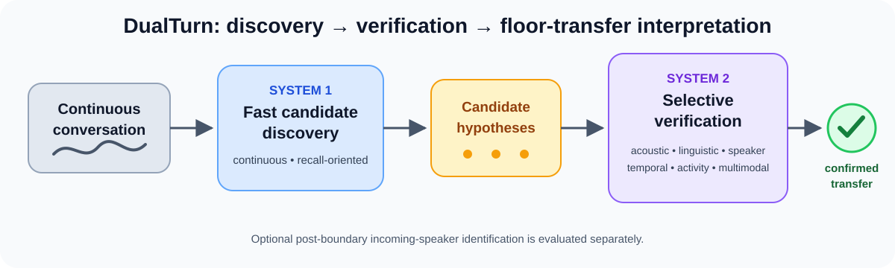
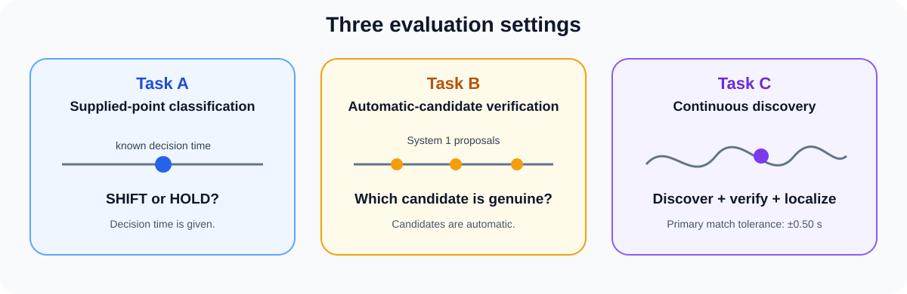
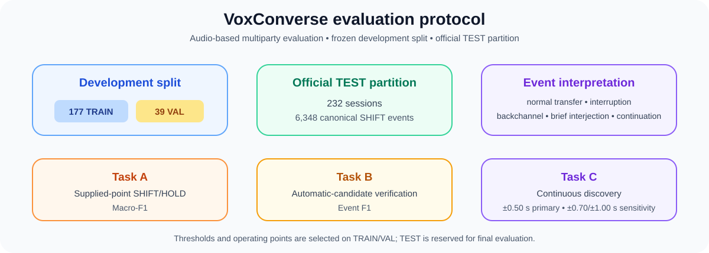
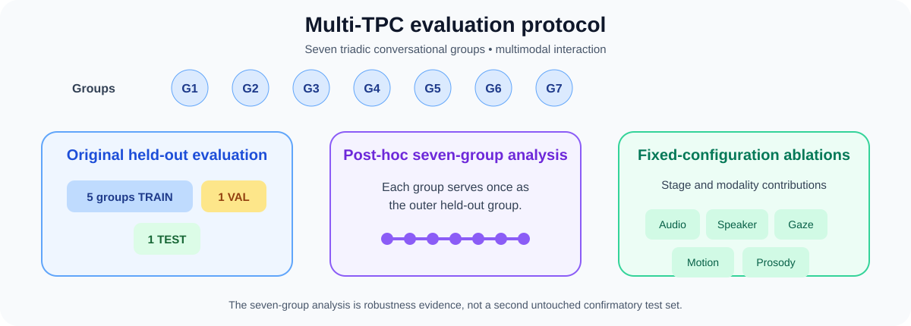

# DualTurn

Code for the paper:

**Leveraging Dual-Process Theory for Multimodal Multiparty Turn-Taking Prediction Using Acoustic and Linguistic Information**

DualTurn predicts floor transfers in multiparty conversation in two stages. A fast discovery stage (System 1) proposes candidate transition points on the continuous timeline. A selective verification stage (System 2) then accepts or rejects each candidate using acoustic, linguistic and, for Multi-TPC, visual and motion evidence.

<p align="center">
  
</p>

## Contents

- [Evaluation tasks](#evaluation-tasks)
- [Results](#results)
- [Notebooks](#notebooks)
- [Installation](#installation)
- [Data](#data)
- [Reproducing the VoxConverse experiments](#reproducing-the-voxconverse-experiments)
- [Reproducing the Multi-TPC experiments](#reproducing-the-multi-tpc-experiments)
- [Experimental notes](#experimental-notes)
- [Repository layout](#repository-layout)
- [Citation](#citation)
- [Acknowledgements](#acknowledgements)

## Evaluation tasks

| Task | Setting | Question answered |
|---|---|---|
| **A** | Supplied-point classification | At a given decision time, is the next event a SHIFT or a HOLD? |
| **B** | Automatic-candidate verification | Is an automatically proposed candidate a genuine floor transfer? |
| **C** | Continuous discovery | Where on the timeline do floor transfers occur? |

Task C matches predicted and reference events one-to-one within a temporal tolerance of ±0.50 s, ±0.70 s or ±1.00 s.

<p align="center">
  
</p>

Reference events are derived from speaker activity and labelled as normal turn transfers (NTT), interruptions (ITT), backchannels (BC), brief interjections (BI) or continuations (HOLD). Only NTT and ITT count as SHIFT events for Task C. A response shorter than 0.50 s that does not take the floor is a BC or BI.

## Results

### VoxConverse (official TEST partition, 232 sessions)

| Analysis | Metric | Result |
|---|---|---:|
| Task A: supplied-point classification | Macro-F1 | 0.849 |
| Task B: automatic-candidate verification | Event F1 | 0.455 |
| Task C: continuous discovery, ±0.50 s | Event F1 | 0.552 |
| Task C: continuous discovery, ±0.70 s | Event F1 | 0.597 |
| Task C: continuous discovery, ±1.00 s | Event F1 | 0.620 |

The TEST reference contains 6,348 SHIFT events. System 1 proposes 80,012 TEST candidates, which cover 6,092 of them (0.960) at ±0.50 s. At ±0.50 s, Task C reaches P = 0.536 and R = 0.569 (3,609 TP, 3,122 FP, 2,739 FN).

### Multi-TPC (seven triadic groups, 23 sessions)

| Protocol | Task A | Task B | Task C F1, ±0.50 s | Task C F1, ±1.00 s |
|---|---:|---:|---:|---:|
| Group-disjoint held-out (1 TEST group) | 0.500 | 0.563 | 0.260 | 0.445 |
| Seven-group nested (mean ± SD over groups) | 0.572 ± 0.045 | 0.607 ± 0.021 | 0.343 ± 0.040 | 0.504 ± 0.050 |

The two rows are separate experiments. The seven-group protocol evaluates a revised system developed after the held-out evaluation, so it adds robustness evidence; it is not a second held-out test of the same model. No paired method comparison or ablation comparison in the seven-group analysis survives Holm correction.

## Notebooks

Run each notebook top to bottom in a fresh kernel. The saved cell outputs are the outputs behind the reported numbers.

| Notebook | Reproduces | Inputs | Notes |
|---|---|---|---|
| `notebooks/voxconverse/voxconverse_main_evaluation.ipynb` | Tasks A/B/C, full augmentation | VoxConverse | Main system |
| `notebooks/voxconverse/voxconverse_ablation_no_augmentation.ipynb` | No-augmentation condition | VoxConverse | Saved without outputs (see [Experimental notes](#experimental-notes)) |
| `notebooks/voxconverse/voxconverse_ablation_synthetic_only.ipynb` | Synthetic-only condition | VoxConverse | |
| `notebooks/voxconverse/voxconverse_ablation_waveform_augmentation.ipynb` | Waveform-augmentation condition | VoxConverse, background beds | |
| `notebooks/voxconverse/voxconverse_silence_and_diagnostics.ipynb` | Silence baselines, augmentation table and paired bootstrap, event-type/speaker-count/overlap diagnostics, runtime | Outputs of the four runs above | Run last |
| `notebooks/multitpc/multitpc_heldout_evaluation.ipynb` | Group-disjoint held-out evaluation and comparators | Multi-TPC, frozen development artifacts | Evaluation only; does not retrain |
| `notebooks/multitpc/multitpc_seven_group_evaluation.ipynb` | Seven-group nested evaluation | Multi-TPC | Trains all models; long run |
| `notebooks/multitpc/multitpc_ablation.ipynb` | Stage and modality ablations | Multi-TPC | Reuses the seven-group run if present |

The step-by-step setup for each dataset is in [`docs/VOXCONVERSE_REPRODUCIBILITY.md`](docs/VOXCONVERSE_REPRODUCIBILITY.md) and [`docs/MULTITPC_REPRODUCIBILITY.md`](docs/MULTITPC_REPRODUCIBILITY.md).

## Installation

The experiments were run with Python 3.11 and PyTorch 2.7.0 (CUDA 11.8) on Linux.

```bash
git clone https://github.com/Ruddy202/DualTurn.git
cd DualTurn
python3.11 -m venv .venv && source .venv/bin/activate
pip install torch==2.7.0 torchaudio==2.7.0 --index-url https://download.pytorch.org/whl/cu118
pip install -r requirements.txt
```

Pretrained models are downloaded from the Hugging Face Hub on first use:

| Model | Used for |
|---|---|
| `microsoft/wavlm-large` | System 1 and System 2 acoustic features |
| `Qwen/Qwen3-1.7B` | Linguistic scores (VoxConverse) |
| `Systran/faster-whisper-medium` (via `faster-whisper`) | ASR transcripts (VoxConverse) |
| `pyannote/speaker-diarization-3.1`, `pyannote/segmentation-3.0` | Diarization (VoxConverse) |
| `speechbrain/spkrec-ecapa-voxceleb` | Speaker embeddings |
| `Haotian-Qi/MuVAP` (role-VAP weights) | MuVAP comparator (Multi-TPC) |

The two pyannote models are gated. Accept their terms on Hugging Face, then export a token before starting Jupyter:

```bash
export HF_TOKEN=<your Hugging Face token>
```

## Data

The datasets are not redistributed here.

- **VoxConverse**: audio and RTTM labels from the [official release](https://github.com/joonson/voxconverse). Use the DEV partition for TRAIN/VAL and the official TEST partition for TEST.
- **Multi-TPC**: obtain the corpus from its authors. The experiments use 23 complete sessions from seven triadic groups.

Default VoxConverse layout (relative to the repository root):

```text
data/voxconverse/
├── voxconverse_dev_wav/audio/     # DEV .wav files
├── voxconverse_test_wav/audio/    # TEST .wav files
├── labels/dev/                    # DEV .rttm files
├── labels/test/                   # TEST .rttm files
└── diffusion_beds_16k/            # background beds for waveform augmentation (optional)
```

For Multi-TPC, point `MULTITPC_ROOT` at the corpus root.

## Reproducing the VoxConverse experiments

The TRAIN/VAL split is fixed by `configs/voxconverse/train_sessions.json` (177 sessions) and `configs/voxconverse/val_sessions.json` (39 sessions). Do not regenerate it.

Run the notebooks in this order:

1. `voxconverse_main_evaluation.ipynb`
2. `voxconverse_ablation_no_augmentation.ipynb`
3. `voxconverse_ablation_synthetic_only.ipynb`
4. `voxconverse_ablation_waveform_augmentation.ipynb`
5. `voxconverse_silence_and_diagnostics.ipynb`

Outputs go to `results/voxconverse/`. The diagnostics notebook reads the four run directories and rebuilds the augmentation table and the 2,000-replicate paired bootstrap from their per-session TEST metrics. Paths, environment variables and expected outputs are listed in [`docs/VOXCONVERSE_REPRODUCIBILITY.md`](docs/VOXCONVERSE_REPRODUCIBILITY.md).

<p align="center">
  
</p>

## Reproducing the Multi-TPC experiments

```bash
export MULTITPC_ROOT=/path/to/Multi-TPC
```

- **Seven-group nested evaluation:** run `multitpc_seven_group_evaluation.ipynb`. It fits and evaluates every outer fold from the raw corpus. This is the longest run in the repository (several days on one GPU).
- **Ablations:** run `multitpc_ablation.ipynb` after the seven-group notebook. It reuses the selected full configuration and feature caches. Without them, it first repeats the nested selection for the full model.
- **Group-disjoint held-out evaluation:** `multitpc_heldout_evaluation.ipynb` scores the TEST group with models and comparator settings frozen during development. Those frozen files are not included in this repository; the notebook stops with an error if they are missing. The files it expects are listed in [`docs/MULTITPC_REPRODUCIBILITY.md`](docs/MULTITPC_REPRODUCIBILITY.md).

The MuVAP comparator uses the source vendored in `third_party/muvap/MuVAP-main/` (upstream commit `a1ef9c8`, MIT licence).

<p align="center">
  
</p>

## Experimental notes

**Information available at prediction time.** The Multi-TPC system is causal: audio windows end at the candidate time and candidates come from causal peak picking. The VoxConverse system uses bounded look-ahead in five places:

- candidate-centred WavLM windows;
- right-side ASR context for the Qwen scores;
- some post-candidate System-2 features;
- symmetric neighbouring-candidate context in the temporal verifier;
- post-candidate evidence in the RR-FAP diagnostics.

No TEST labels enter any feature or prediction.

**Names in code.** In the VoxConverse notebooks, `Branch 2` = Task A, `Branch 2E` = Task B, `Branch 1` = Task C, and `Branch 3` is the future-activity diagnostic. In the Multi-TPC held-out notebook, `R10_*` is the candidate-proposal stack, `R11_*` is the proposed held-out system, and `V17_*` is shared timeline code. These prefixes are part of its frozen-artifact filenames and code fingerprint.

**Matching tolerance during training.** VoxConverse uses ±0.50 s to label candidates and select operating points. Multi-TPC uses ±1.00 s (`PRIMARY_EVENT_TOLERANCE`) for the same purpose. Both datasets report Task C at all three tolerances.

**Bootstrap.** VoxConverse Task C confidence intervals use 1,000 session-level bootstrap replicates. The VoxConverse augmentation comparison uses 2,000 paired session-level replicates. The Multi-TPC seven-group and ablation analyses use 10,000 replicates.

**No-augmentation run.** The no-augmentation notebook was saved without cell outputs. Its results come from that run's output directory, and the diagnostics notebook (step 5) reports them alongside the other conditions.

**Re-running.** The seven-group and ablation notebooks hash their own source code into the run directory name. A fresh run therefore writes to a new directory and does not reuse caches from an earlier run.

**Hardware.** The VoxConverse experiments and the Multi-TPC held-out evaluation were run on one NVIDIA RTX 4070 (12 GB). The Multi-TPC ablations were run on one RTX 4080 SUPER (16 GB). The notebooks fall back to CPU for some stages if free GPU memory is low (`CUDA_MIN_FREE_GB_FOR_MAIN`, `FORCE_MAIN_CPU`).

## Repository layout

```text
DualTurn/
├── README.md
├── requirements.txt
├── configs/voxconverse/          # fixed TRAIN/VAL session lists
├── notebooks/
│   ├── voxconverse/              # 5 notebooks
│   └── multitpc/                 # 3 notebooks
├── docs/
│   ├── VOXCONVERSE_REPRODUCIBILITY.md
│   └── MULTITPC_REPRODUCIBILITY.md
├── figures/readme/               # figures used in this README
└── third_party/muvap/            # vendored MuVAP source (MIT)
```

`data/` and `results/` are created locally and are ignored by git.

## Citation

The BibTeX entry will be added once the paper is published. Until then, cite the paper by title:

> *Leveraging Dual-Process Theory for Multimodal Multiparty Turn-Taking Prediction Using Acoustic and Linguistic Information.*

## Acknowledgements

The Multi-TPC comparator builds on [MuVAP](https://github.com/Haotian-Qi/MuVAP) (MIT licence), vendored in `third_party/muvap/`. We thank the creators of VoxConverse and Multi-TPC for making their data available.
