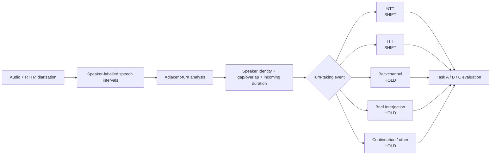

# Reproducing the VoxConverse experiments

This guide covers setup, run order and outputs for the five VoxConverse notebooks. For installation, see the [README](../README.md#installation).

## 1. Data

VoxConverse is distributed by its authors:

- RTTM annotations: https://github.com/joonson/voxconverse (use the current v0.3 annotations on the master branch, which include corrected TEST labels)
- DEV audio: https://www.robots.ox.ac.uk/~vgg/data/voxconverse/data/voxconverse_dev_wav.zip
- TEST audio: https://www.robots.ox.ac.uk/~vgg/data/voxconverse/data/voxconverse_test_wav.zip

From the repository root, the following commands build the default layout:

```bash
mkdir -p data/voxconverse/voxconverse_dev_wav/audio data/voxconverse/voxconverse_test_wav/audio data/voxconverse/labels
wget https://www.robots.ox.ac.uk/~vgg/data/voxconverse/data/voxconverse_dev_wav.zip
wget https://www.robots.ox.ac.uk/~vgg/data/voxconverse/data/voxconverse_test_wav.zip
unzip -q voxconverse_dev_wav.zip -d data/voxconverse/voxconverse_dev_wav/audio
unzip -q voxconverse_test_wav.zip -d data/voxconverse/voxconverse_test_wav/audio
git clone https://github.com/joonson/voxconverse.git /tmp/voxconverse
cp -r /tmp/voxconverse/dev  data/voxconverse/labels/dev
cp -r /tmp/voxconverse/test data/voxconverse/labels/test
```

The notebooks search these folders recursively, so an extra subfolder level from the zip files does no harm.

```text
data/voxconverse/
├── voxconverse_dev_wav/audio/     # DEV .wav files (216 sessions)
├── voxconverse_test_wav/audio/    # TEST .wav files (232 sessions)
├── labels/dev/                    # DEV .rttm files
├── labels/test/                   # TEST .rttm files
└── diffusion_beds_16k/            # background beds (.wav, 16 kHz), optional
```

These paths are the defaults; you can change them with the environment variables in section 4.

`diffusion_beds_16k/` holds the 96 background recordings mixed in by waveform augmentation. They are not part of VoxConverse and are not included here. If the folder is empty or missing, the notebooks skip bed mixing and print a warning. Random gain and Gaussian noise are still applied.

## 2. Split

| Partition | Sessions | Source |
|---|---:|---|
| TRAIN | 177 | `configs/voxconverse/train_sessions.json` |
| VAL | 39 | `configs/voxconverse/val_sessions.json` |
| TEST | 232 | Official VoxConverse TEST partition |

TRAIN and VAL are disjoint and together cover the 216 DEV sessions. The notebooks read these files. Do not regenerate the split.

## 3. Turn-taking events

VoxConverse is a diarization corpus: its RTTM files say who spoke when, but contain no turn-taking labels. The main notebook derives events from each pair of adjacent speaker segments.



| Adjacent-segment pattern | Event | Label | Event time |
|---|---|---|---|
| Same speaker continues | NA / continuation | HOLD | previous segment end |
| Different speaker, overlap ≥ 0.06 s, incoming duration ≤ 0.50 s | Backchannel (BC) | HOLD | incoming segment start |
| Different speaker, overlap ≥ 0.06 s, incoming duration > 0.50 s | Interruption turn transfer (ITT) | SHIFT | incoming segment start |
| Different speaker, no substantial overlap, incoming duration ≤ 0.50 s | Brief interjection (BI) | HOLD | incoming segment start |
| Different speaker, no substantial overlap, incoming duration > 0.50 s | Normal turn transfer (NTT) | SHIFT | previous segment end |

Events with missing timestamps are dropped, event times are canonicalized, and duplicate events at the same session time are removed. On TEST this gives 6,348 SHIFT events.

## 4. Configuration

Every notebook resolves its paths from the repository root. Override them with environment variables before starting Jupyter.

| Variable | Default | Purpose |
|---|---|---|
| `PROJECT_ROOT` | repository root | Base for all relative paths |
| `VOX_ROOT` | `data/voxconverse` | Dataset root (layout above) |
| `VOX_SPLITS_DIR` | `configs/voxconverse` | TRAIN/VAL manifests |
| `VOX_RUN_ROOT` | `results/voxconverse/18thAug_VAP_RRFAP_TEXT_META_CONFIRMER_PAPER_READY_v2` | Output directory of the main run |
| `VOX_BASE_ASSET_RUN_ROOT` | `results/voxconverse/18thAug_VAP_RRFAP_TEXT_META_CONFIRMER_v1` | Optional earlier run. If it exists, its synthetic dialogues, augmented audio and ASR/pyannote/ECAPA caches are reused read-only; otherwise they are generated |
| `HF_TOKEN` (or `HUGGINGFACE_HUB_TOKEN`) | — | Needed for the gated pyannote models |

The run-directory names are fixed in the code. The diagnostics notebook finds the ablation runs by appending a suffix to the main run name, so keep the defaults unless you change all five notebooks consistently.

Additional variables for `voxconverse_silence_and_diagnostics.ipynb`:

| Variable | Default | Purpose |
|---|---|---|
| `VOX_RUNS_DIR` | `results/voxconverse` | Parent directory of the four runs |
| `VOX_ANALYSIS_RUN_ROOT` | main run directory | Run to analyse |
| `VOX_RTTM_TEST` | `$VOX_ROOT/labels/test` | TEST RTTM files |
| `VOX_AUDIO_TEST` | `$VOX_ROOT/voxconverse_test_wav/audio` | TEST audio |
| `VOX_AUG_CAMPAIGN_RESULT_DIR` | `results/voxconverse/augmentation_ablation_campaign` | Optional precomputed augmentation tables; recomputed from the four runs if absent |
| `VOX_RUN_TRUE_TIMING_BENCHMARK` | `1` | Run the component runtime benchmark |
| `VOX_EXPORT_AUDIT_AUDIO` | `1` | Export audio snippets for the manual label audit |
| `VOX_MANUAL_AUDIT_TOTAL` | `300` | Number of events sampled for the manual audit |

## 5. Run order

| Step | Notebook | Writes to `results/voxconverse/` |
|---|---|---|
| 1 | `voxconverse_main_evaluation.ipynb` | `<run>/` |
| 2 | `voxconverse_ablation_no_augmentation.ipynb` | `<run>__aug_ablation_no_aug/` |
| 3 | `voxconverse_ablation_synthetic_only.ipynb` | `<run>__aug_ablation_synthetic_only/` |
| 4 | `voxconverse_ablation_waveform_augmentation.ipynb` | `<run>__aug_ablation_diffusion_only/` |
| 5 | `voxconverse_silence_and_diagnostics.ipynb` | `<run>/paper_analysis_voxconverse/` |

`<run>` is `18thAug_VAP_RRFAP_TEXT_META_CONFIRMER_PAPER_READY_v2`. Steps 2–4 can run in any order after step 1. Step 5 needs all four runs.

Each run directory contains trained models (`models/`), TEST metrics (`eval/`) and feature caches. `eval/` includes `final_test_metrics_per_session.csv`, which step 5 uses for the paired bootstrap.

## 6. Conditions

| Notebook | Real dialogue | Synthetic dialogue | Waveform augmentation |
|---|:---:|:---:|:---:|
| Main evaluation (full) | ✓ | ✓ | ✓ |
| No augmentation | ✓ | | |
| Synthetic only | ✓ | ✓ | |
| Waveform augmentation | ✓ | | ✓ |

Waveform augmentation uses random gain, Gaussian noise and background-bed mixing. All three keep the original timing; the experiments do not use speed perturbation or time shifting.

## 7. Evaluation settings

- Task C matches events one-to-one at ±0.50 s (also used for candidate labelling and operating-point selection), ±0.70 s and ±1.00 s.
- The TEST reference contains 6,348 SHIFT events.
- Task C confidence intervals use 1,000 session-level bootstrap replicates.
- The augmentation comparison uses 2,000 paired session-level bootstrap replicates.

## 8. Models

| Model | Source |
|---|---|
| WavLM | `microsoft/wavlm-large` (falls back to `microsoft/wavlm-base-plus` if the large model cannot be loaded) |
| Language model | `Qwen/Qwen3-1.7B` with a LoRA adapter trained in the notebook |
| ASR | `faster-whisper` `medium` |
| Diarization | `pyannote/speaker-diarization-3.1` (gated), `pyannote/segmentation-3.0` (gated) |
| Speaker embeddings | `speechbrain/spkrec-ecapa-voxceleb` |

All weights are downloaded from their upstream sources on first use.

## 9. Hardware

The original runs used one NVIDIA RTX 4070 (12 GB) with Python 3.11.15 and PyTorch 2.7.0+cu118.
