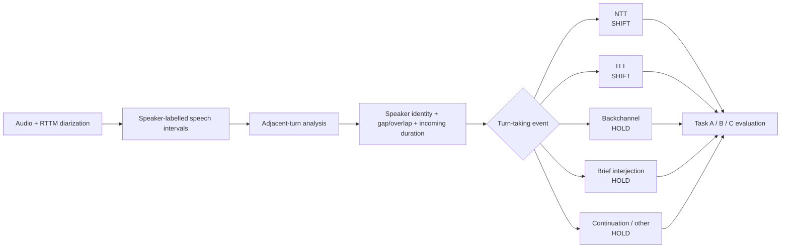

# VoxConverse reproducibility

This document provides the practical information needed to reproduce the VoxConverse experiments released with this repository.

## Files

```text
notebooks/voxconverse/
├── voxconverse_main_evaluation.ipynb
├── voxconverse_ablation_no_augmentation.ipynb
├── voxconverse_ablation_synthetic_only.ipynb
├── voxconverse_ablation_waveform_augmentation.ipynb
└── voxconverse_silence_and_diagnostics.ipynb

configs/voxconverse/
├── train_sessions.json
└── val_sessions.json
```

The main notebook contains the full-condition Task A/B/C experiment. The remaining notebooks provide the augmentation conditions and secondary diagnostics reported in the paper.

## Dataset and split

Obtain VoxConverse from its official source. Dataset audio and annotations are not redistributed in this repository.

Use the supplied frozen development manifests:

- TRAIN: 177 sessions
- VAL: 39 sessions
- TEST: official VoxConverse TEST partition

`train_sessions.json` and `val_sessions.json` are disjoint and together contain the 216 DEV sessions used by the experiments.

Do not regenerate the TRAIN/VAL split.

## How VoxConverse is repurposed for turn-taking

VoxConverse is originally a speaker-diarization corpus: its RTTM files describe **who spoke when**, but they do not provide turn-taking labels. The main notebook converts adjacent speaker segments into the event classes used by this study.



The primary conversion rules are:

| Adjacent-segment pattern | Derived event | Label | Event time |
|---|---|---|---|
| Same speaker continues | NA / continuation | HOLD | previous segment end |
| Different speaker, overlap ≥ 0.06 s, incoming duration ≤ 0.50 s | Backchannel (BC) | HOLD | incoming segment start |
| Different speaker, overlap ≥ 0.06 s, incoming duration > 0.50 s | Interruption turn transfer (ITT) | SHIFT | incoming segment start |
| Different speaker, no substantial overlap, incoming duration ≤ 0.50 s | Brief interjection (BI) | HOLD | incoming segment start |
| Different speaker, no substantial overlap, incoming duration > 0.50 s | Normal turn transfer (NTT) | SHIFT | previous segment end |

After event construction, missing timestamps are removed, event times are canonicalized, and duplicate session-time events are removed before evaluation.

## Evaluation settings

The released evaluation uses:

- **Task A:** supplied-point SHIFT/HOLD classification;
- **Task B:** automatic-candidate verification;
- **Task C:** continuous floor-transfer discovery.

For Task C:

- primary matching tolerance: ±0.50 s;
- sensitivity tolerances: ±0.70 s and ±1.00 s;
- matching: one-to-one;
- canonical TEST reference: 6,348 unique SHIFT events.

## Augmentation conditions

The public notebooks cover:

- no augmentation;
- synthetic-only augmentation;
- waveform augmentation;
- full augmentation in the main evaluation notebook.

The waveform-augmentation condition uses timing-preserving random gain, Gaussian noise, and optional background-bed mixing. Speed perturbation and temporal shifting are not used in the released experiment.

## Bootstrap settings

- main Task-C confidence interval: 1,000 session-level bootstrap replicates;
- paired augmentation comparison: 2,000 paired session-level bootstrap replicates.

## Running the notebooks

Configure the dataset and output roots in the notebook configuration cell, then use the supplied TRAIN/VAL manifests.

The public notebooks retain outputs from the original executions and were not re-executed after repository sanitization.

## Data redistribution

VoxConverse audio and annotation files are not included in this repository. Users must obtain the dataset separately from its official distribution.
